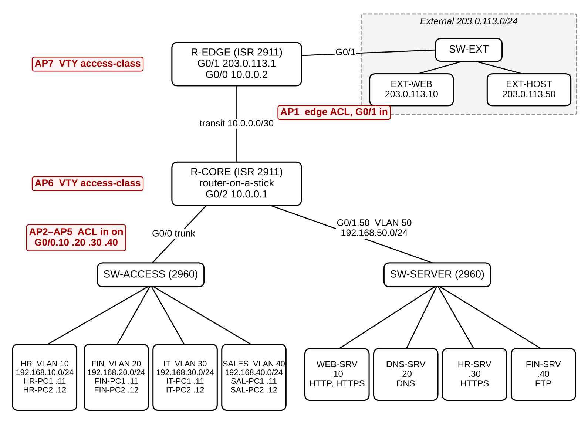
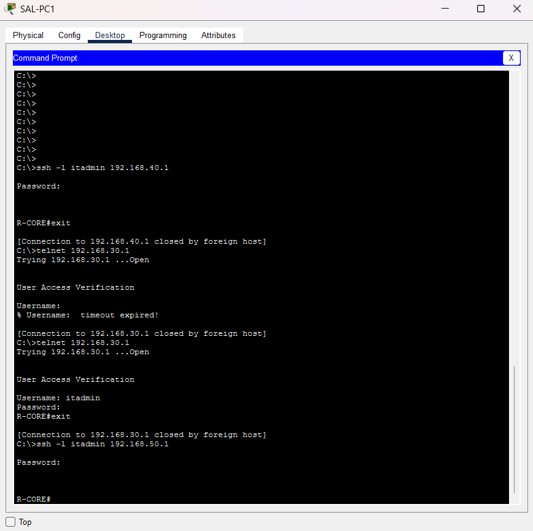
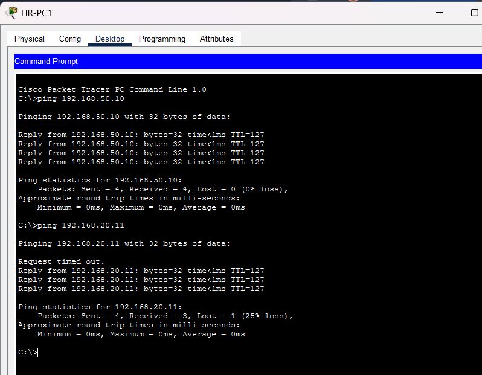
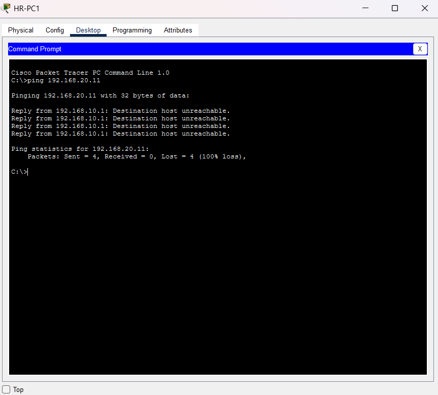
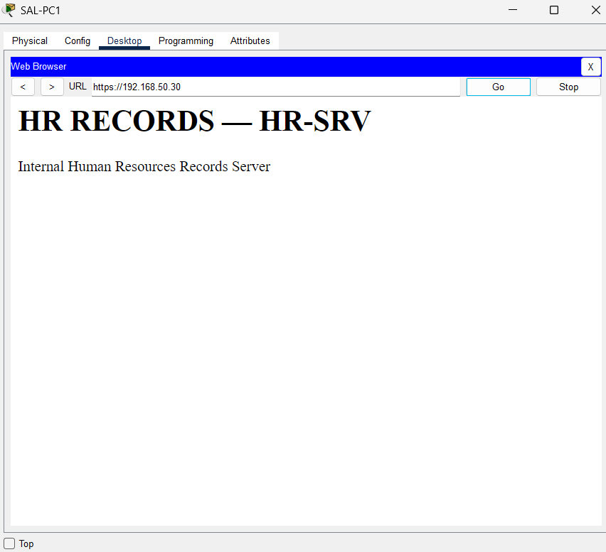
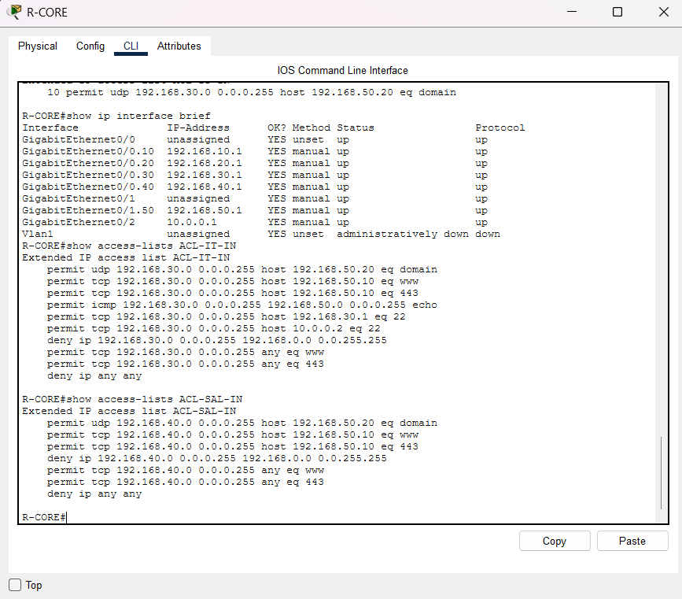
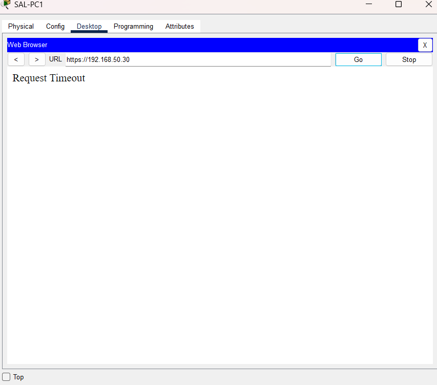
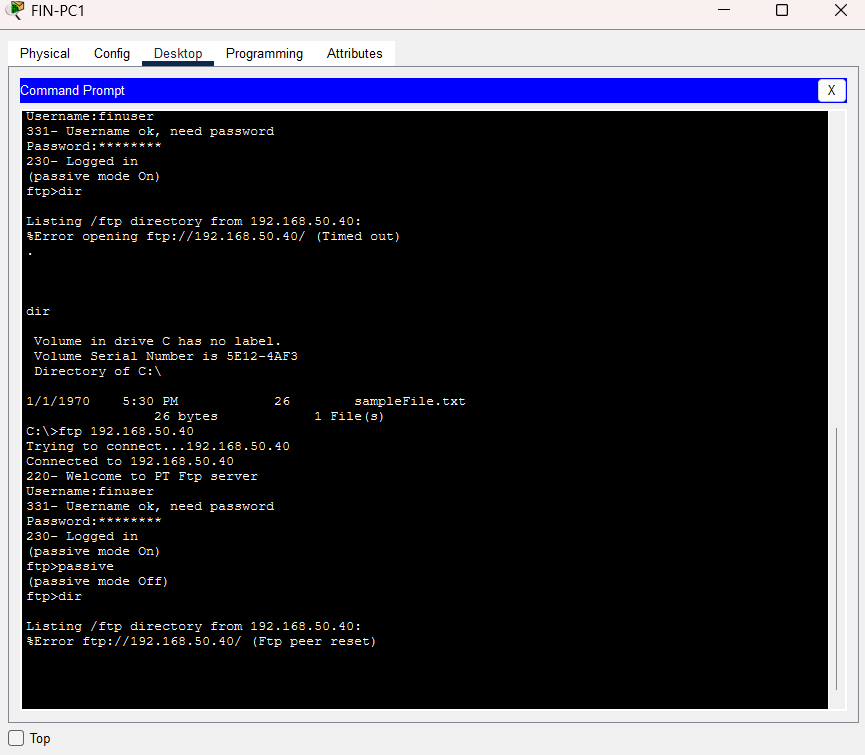

| Item | Details |
|------------------|--------------------------------------------------------------------|
| **Course** | BACSE203 Computer Networks, Fall 2026, School of Computer Science and Engineering, VIT Vellore |
| **Topic** | 17. Firewall Policy Complexity: From Simple ACLs to Least Privilege Network Access |
| **Team name** |  |
| **Member 1** | Ram —  |
| **Member 2** | Darshan —  |
| **Member 3** | Aadhavan —  |
| **Member 4** | Naveen —  |
| **Member 5** | Himenesh —  |
| **Faculty** |  |
| **Submission date** | 20 October 2026 |

**Status at submission.** Parts A, B and C are complete. The Cisco Packet Tracer simulation was run for Stages 0–3. Where a test has no screenshot it is marked *n/e* (not evidenced) and is left out of every count; nothing is reported that the screenshots do not show.

**List of tables.**

1. Comparison of access-control approaches
2. Required and forbidden flows
3. Device inventory
4. VLAN and addressing plan
5. What changes between policy stages
6. ACL size and structure per stage (from configuration)
7. Test cases: planned outcomes and observed results
8. Misconfiguration experiments
9. Metrics: planned and measured values
10. Alignment with the literature

**List of figures.** Figure 1 is a design drawing made from our addressing plan. Figures 2–11 are screenshots from our own Packet Tracer files (B10).

\newpage

# PART A — Review Paper

## Firewall Policy Complexity: A Thematic Review of Perimeter Filtering, Least Privilege and Policy Management

### Abstract

Router access control lists (ACLs) and firewalls are still the most widely used way to control which hosts may talk to which, yet they protect a network only as well as the policy written into them. This paper reviews research papers, standards and government guidance on firewall and ACL policy management under five themes: perimeter filtering, policy anomalies, policy growth and misconfiguration, least privilege with microsegmentation and Zero Trust, and policy-management approaches.

Across these themes the sources agree that real rule sets are often misconfigured, that rule order hides conflicts, and that network location alone is a weak basis for trust. They disagree on two points. The first is whether finer-grained policy really lowers risk, since empirical work links rule-set complexity to errors. The second is whether automated tooling removes that tension.

Four gaps stand out. The empirical evidence rests on a few older datasets; unnecessary access is rarely measured against stated requirements; security gain and management cost are seldom measured on the same policy; and management tools are seldom evaluated with real users. To address the third gap on a small scale, we design a Packet Tracer case study that measures both on one network.

**Keywords:** firewall policy, access control list, least privilege, policy anomalies, microsegmentation, Zero Trust.

### 1. Introduction

A packet filter is only as good as its rules. Wool's analysis of real corporate rule sets [1] was the first quantitative study of firewall configuration quality. A larger follow-up [2] concluded that firewalls were still poorly configured, and that the more complex a rule set was, the more risk items it tended to contain.

Standards guidance sets a demanding target: block all traffic that has not been expressly permitted, and derive the permitted traffic from a risk analysis of what the organisation actually needs [3]. Zero Trust guidance goes further, granting no implicit trust on the basis of network location [4]. Both restate the much older principle of least privilege [5].

These positions create the tension this review examines. A broad policy is short and easy to write, but it allows far more communication than anyone needs. A least-privilege policy allows only what is needed, but it has more rules, more conditions and more dependence on rule order, which are exactly the properties that [2] associates with configuration errors. We ask how the literature treats this trade-off, and where its evidence is thin.

**Method.** Sources were identified through IEEE Xplore, the ACM Digital Library, Google Scholar, the IETF RFC series and the NIST and CISA publication catalogues, using terms such as *firewall policy anomaly*, *firewall configuration errors*, *ACL shadowing*, *least privilege*, *microsegmentation* and *zero trust architecture*. We preferred peer-reviewed papers and original standards. Government guidance and one practitioner article are used only as supporting context, and are labelled as such in the reference list.

Section 2 reviews the literature by theme, Section 3 compares the approaches and gives our interpretation, and Section 4 concludes.

### 2. Literature Review

#### 2.1 Perimeter Filtering and the Trusted-Inside Assumption

The classical firewall sits at the boundary between an organisation and the Internet. RFC 2979 [6] describes firewalls as packet filters, protocol relays or a mix of both, and notes that their behaviour was often under-specified, which caused problems in practice. NIST SP 800-41 Rev. 1 [3] gives the operational model that most later work assumes: write an explicit policy for both inbound and outbound traffic, allow only the IP protocols that are needed, block everything not expressly permitted, and keep the policy up to date. RFC 2827 [7] adds ingress filtering, which drops traffic whose source address does not belong to the network it arrives from. Our broad stage in Part B does **not** implement this kind of source validation. Its internal ACL only checks, coarsely, that a source address lies inside the organisation's address block, so the inside of the network stays open.

These sources agree that a default-deny boundary is the minimum acceptable posture. Later work questions whether the boundary is the right place to decide trust at all: Ward and Beyer [8] describe an enterprise that abandoned its privileged internal network and granted access based on user and device credentials instead. The perimeter literature says little about traffic *between* internal segments, and that gap is where our case study begins.

#### 2.2 Policy Anomalies: Ordering, Shadowing and Redundancy

Because ACLs are evaluated first-match-wins, the meaning of any rule depends on every rule above it. Al-Shaer and Hamed [9] formalised the anomalies this produces, and Al-Shaer *et al.* [10] extended them to distributed firewalls and automated their discovery in the *Firewall Policy Advisor*. We use four of their anomaly classes:

- **Shadowing:** an earlier rule with a different action matches every packet of a later rule, so the later rule never takes effect.
- **Correlation:** rules with different actions partially overlap.
- **Generalisation:** a later rule covers a superset of an earlier rule's packets with the opposite action.
- **Redundancy:** a rule can be removed without changing what the policy does.

Other authors attack the same problem from different directions. FIREMAN [11] applies static analysis, modelling every packet and path with binary decision diagrams to flag violations and inconsistencies; its authors report real misconfigurations found in enterprise networks. Gouda and Liu [12] aim to prevent anomalies rather than find them: policies are written as firewall decision diagrams, which are conflict-free and complete by construction, and then compiled into a compact rule list.

The four works agree that order dependence is the root cause of anomalies, but they intervene at different times: [9]–[11] audit rules that already exist, while [12] works at design time. All of them rely mainly on formal analysis or tool case studies rather than on evidence of how often administrators actually introduce anomalies. In Part B we count order-dependent rule pairs in each policy stage, and we deliberately reproduce a shadowed rule (experiment M1).

#### 2.3 Policy Growth, Misconfiguration and Excessive Permissions

Wool's two studies [1], [2] are the strongest empirical evidence we found. The second used a larger dataset from two vendors, introduced a composite *firewall complexity* measure, and found no significant sign that newer software versions had fewer errors [2]. This suggests that complexity, rather than the raw number of rules, is what tracks risk. Voronkov *et al.* [13] reach a compatible conclusion from the usability literature: configuration is complicated and error-prone, it gets worse as networks grow, and the solutions proposed for it are rarely validated with real users.

The sources agree that misconfiguration is common and that complexity contributes to it. However, the datasets in [1] and [2] are now old, and neither measures *excessive permission*, meaning access the policy allows but the business does not need. This is why Part B defines unnecessary access against a requirements matrix that we wrote before writing any rule.

#### 2.4 Least Privilege, Microsegmentation and Zero Trust

Two of Saltzer and Schroeder's design principles [5] run through this whole literature: *least privilege*, under which every program and user operates with the smallest set of privileges it needs, and *fail-safe defaults*, under which access is decided by permission rather than by exclusion. NIST SP 800-207 [4] applies them to networks. It grants no implicit trust on the basis of location or asset ownership, authenticates and authorises subjects and devices before every session, and protects resources rather than network segments.

Microsegmentation is one way of putting this into practice. Syed *et al.* [14] identify it as one building block of Zero Trust, alongside authentication, access control, encryption and automation. NIST SP 800-215 [15] argues that the enterprise perimeter has effectively disappeared and that broad internal connectivity lets attackers move laterally, and it presents microsegmentation, Zero Trust network access and software-defined perimeters as responses. CISA [16] likewise presents microsegmentation as a way to shrink the attack surface and limit lateral movement, while acknowledging that it is hard to implement.

These sources agree that location-based trust is not enough and that segmentation limits lateral movement. There is an unresolved tension, though: microsegmentation multiplies policy boundaries and rules, the very property [2] links to errors, and the guidance we found does not quantify that cost. Most of it is also guidance rather than peer-reviewed measurement. Router ACLs cannot provide identity-aware, continuously verified access [4], so the least-privilege stage in Part B is a network-layer approximation of these ideas, not an implementation of Zero Trust.

#### 2.5 Policy-Management Approaches

Three families of approach try to make fine-grained policy manageable. Firmato [17] works at *specification* time: it keeps policy and topology in one entity-relationship model and compiles that model into vendor configurations, and its prototype ran an operational firewall for several months. FIREMAN [11] and the Firewall Policy Advisor [10] work at *audit* time, checking existing policies for anomalies. Firewall decision diagrams [12] work at *design* time, producing rule sets that are consistent, complete and compact.

All three share the premise that administrators should not hand-edit long, ordered rule lists; they differ in where they step in. What none of them has shown convincingly is that they reduce human error in practice. Voronkov *et al.* [13] found that such proposals rarely include usability evaluation, so the claim that tooling removes the cost of least privilege remains largely untested with real administrators.

#### 2.6 Research Gaps Across Themes

Four gaps recur across the themes:

1. The empirical misconfiguration data are dated and come from few sources [1], [2].
2. Excessive permission is rarely measured against stated requirements.
3. Security gain and management cost are seldom measured together, on the same policy, as it is refined.
4. The usability of management tools is under-evaluated [13].

### 3. Comparative Discussion and Analysis

**Table 1. Comparison of access-control approaches in the reviewed literature**

| Approach | Where trust is decided | Granularity | Main strength | Main weakness or open issue | Sources |
|----------------|--------------|------------|--------------|----------------|---------|
| Perimeter filtering | Network boundary | Zone or subnet | Simple; clear default deny | Little control of internal (lateral) traffic | [3], [6], [7] |
| Department or zone segmentation | Internal zone boundaries | Subnet | Blocks cross-department paths | Whole zones still trusted | [15] |
| Service-level least privilege (ACL) | Every enforcement point | Host + protocol + port | Minimal required reachability | More rules; more order dependence | [2], [5], [9] |
| Microsegmentation / Zero Trust | Per resource or session; identity-aware | Workload or session | Limits lateral movement; no location-based trust | Management cost; little peer-reviewed measurement | [4], [14]–[16] |
| Policy-management tooling | Specification, design or audit | Any | Detects or prevents anomalies | Usability rarely evaluated | [10]–[13], [17] |

**Is a broader policy easier to administer?** In the narrow sense, yes: it has fewer rules and fewer order dependencies to reason about. But [3] asks that only needed traffic be allowed, and a broad internal policy does not achieve that. Simplicity is bought at the cost of standards compliance.

**Does finer granularity reduce unnecessary access?** In principle it must, and [4], [5] and [16] argue for it on that basis. However, none of the empirical studies we found measures the reduction against a written list of required flows, which is the measurement Part B is designed to make.

**Is rule count a fair measure of complexity?** The evidence suggests not. Wool's complexity measure deliberately goes beyond counting rules [2], and the anomaly literature [9]–[12] shows that two short policies can differ greatly in risk depending on rule order and overlap. Our inference is that **order dependence and the number of enforcement points** are better guides to management difficulty than rule count. Part B tests this on a small scale.

**Does tooling remove the trade-off?** The tools in [10]–[12] and [17] reduce anomalies either by construction or by detection. Without usability studies [13], however, their effect on human error is asserted rather than demonstrated, so we treat tooling as a mitigation rather than as evidence that least privilege comes at no cost.

**Does microsegmentation change the management model?** It does. It moves enforcement next to each workload and, in its Zero Trust form, ties access decisions to identity [4], [14]. That removes the trusted-inside assumption, but it multiplies the number of policy objects, a cost the sources we found do not quantify.

**Our interpretation.** Taken together, the literature supports a *conditional* position. Least privilege reduces exposure, but its management cost is real, it appears to grow with order dependence and the number of enforcement points, and tooling offsets it only in part. Plain ACLs remain a reasonable choice for small, stable networks whose required flows are well understood; they are not sufficient where identity, device state or continuous verification must drive access decisions [4], [8].

### 4. Conclusion and Future Scope

The sources we reviewed agree that misconfiguration is common, that rule order creates conflicts that are hard to see, and that network location is a weak basis for trust. They disagree, often implicitly, on whether finer-grained policy lowers net risk once its complexity is counted, and on how far automation changes that balance. The weakest points in the evidence are the age of the empirical datasets, the lack of measurements of unnecessary access against stated requirements, and the lack of usability evaluations of management tools.

Future work should measure security gain and management cost together, on the same policy, as it is refined. Part B of this report sets up exactly that comparison in a controlled Packet Tracer network, comparing broad, department-level and service-level policies over the same test cases and enforcement points. A study of this size cannot be generalised; work with real administrators and real rule sets would be needed for that.

### References (shared by Parts A, B and C)

The references follow IEEE style. DOIs or URLs are given where an authoritative listing showed them.

[1] A. Wool, "A quantitative study of firewall configuration errors," *Computer*, vol. 37, no. 6, pp. 62–67, Jun. 2004. [Online]. Available: https://ieeexplore.ieee.org/document/1306389

[2] A. Wool, "Trends in firewall configuration errors: Measuring the holes in Swiss cheese," *IEEE Internet Computing*, vol. 14, no. 4, pp. 58–65, 2010. (Extended version: arXiv:0911.1240.)

[3] K. Scarfone and P. Hoffman, "Guidelines on firewalls and firewall policy," NIST, Gaithersburg, MD, USA, Special Publication 800-41 Rev. 1, Sep. 2009, doi: 10.6028/NIST.SP.800-41r1.

[4] S. Rose, O. Borchert, S. Mitchell, and S. Connelly, "Zero trust architecture," NIST, Gaithersburg, MD, USA, Special Publication 800-207, Aug. 2020, doi: 10.6028/NIST.SP.800-207.

[5] J. H. Saltzer and M. D. Schroeder, "The protection of information in computer systems," *Proc. IEEE*, vol. 63, no. 9, pp. 1278–1308, Sep. 1975.

[6] N. Freed, "Behavior of and requirements for Internet firewalls," IETF, RFC 2979, Oct. 2000.

[7] P. Ferguson and D. Senie, "Network ingress filtering: Defeating denial of service attacks which employ IP source address spoofing," IETF, BCP 38, RFC 2827, May 2000, doi: 10.17487/RFC2827.

[8] R. Ward and B. Beyer, "BeyondCorp: A new approach to enterprise security," *;login:*, vol. 39, no. 6, Dec. 2014. *(Practitioner article; supporting context.)*

[9] E. Al-Shaer and H. Hamed, "Discovery of policy anomalies in distributed firewalls," in *Proc. IEEE INFOCOM 2004*, pp. 2605–2616.

[10] E. Al-Shaer, H. Hamed, R. Boutaba, and M. Hasan, "Conflict classification and analysis of distributed firewall policies," *IEEE J. Sel. Areas Commun.*, vol. 23, no. 10, pp. 2069–2083, Oct. 2005, doi: 10.1109/JSAC.2005.854119.

[11] L. Yuan, J. Mai, Z. Su, H. Chen, C.-N. Chuah, and P. Mohapatra, "FIREMAN: A toolkit for FIREwall modeling and ANalysis," in *Proc. IEEE Symp. Security and Privacy*, 2006, pp. 199–213, doi: 10.1109/SP.2006.16.

[12] M. G. Gouda and A. X. Liu, "Structured firewall design," *Computer Networks*, vol. 51, no. 4, pp. 1106–1120, 2007.

[13] A. Voronkov, L. H. Iwaya, L. A. Martucci, and S. Lindskog, "Systematic literature review on usability of firewall configuration," *ACM Comput. Surv.*, vol. 50, no. 6, Art. no. 87, 2017, doi: 10.1145/3130876.

[14] N. Syed, S. W. Shah, A. Shaghaghi, A. Anwar, Z. Baig, and R. Doss, "Zero trust architecture (ZTA): A comprehensive survey," *IEEE Access*, vol. 10, pp. 57143–57179, 2022. [Online]. Available: https://ieeexplore.ieee.org/document/9773102

[15] R. Chandramouli, "Guide to a secure enterprise network landscape," NIST, Gaithersburg, MD, USA, Special Publication 800-215, Nov. 2022, doi: 10.6028/NIST.SP.800-215.

[16] Cybersecurity and Infrastructure Security Agency, "Microsegmentation in zero trust, part one: Introduction and planning," CISA, Jul. 2025. *(Government guidance; supporting context.)*

[17] Y. Bartal, A. Mayer, K. Nissim, and A. Wool, "Firmato: A novel firewall management toolkit," *ACM Trans. Comput. Syst.*, vol. 22, no. 4, pp. 381–420, Nov. 2004, doi: 10.1145/1035582.1035583.

[18] J. Arkko, M. Cotton, and L. Vegoda, "IPv4 address blocks reserved for documentation," IETF, RFC 5737, Jan. 2010.

**Source mix.**

| Category | Count | References |
|---|---|---|
| Peer-reviewed papers | 10 | [1], [2], [5], [9]–[14], [17] |
| IETF RFCs | 3 | [6], [7], [18] |
| NIST publications | 3 | [3], [4], [15] |
| Supporting context | 2 | [8], [16] |
| **Total** | **18** | Required: at least 15, including at least 8 peer-reviewed papers or original standards. |

\newpage

# PART B — Simulation-Based Case Study

> **Scope.** The same 17 of the 26 designed test cases were planned for every stage; the other nine are marked *not run*. Planned outcomes come from tracing packets through the rules by hand; observed outcomes come only from our Packet Tracer screenshots. Two extra tests (T02, T09) were captured in Stage 3 and are reported separately.

## B1. Introduction, Problem Statement and Objectives

**Problem statement.** Many small organisations run an internal network in which every department can reach every other department and every server. A router ACL can close those paths, but each step towards least privilege adds rules, conditions and dependence on rule order. Part A found that the literature rarely measures the security gained and the management cost incurred on the same policy as it is refined. This case study does that, on a small scale, in a simulated enterprise network.


**Research question.** How does refining network access policy from broad, to department-level, to service-level least privilege change (a) the unnecessary flows the policy allows and (b) the policy's size, specificity, and dependence on rule order, and how do these results compare with the literature?

**What we compare.** We compare three **policy stages**. Each stage changes several things at once (Table 5): the structure of the internal ACLs, their granularity, the edge filter and the rules for router management. We therefore attribute any difference to the stage as a whole, not to granularity alone.

To keep the comparison fair, we hold the following constant in every stage: the topology, addressing, routing and server services; the required and forbidden flows; the seven points where filters are applied; and the same 17 test cases (of 26 designed), run with the same methods. Our conclusions are limited to those 17 test cases and to the traffic directions listed in B7.

**Objectives.**

1. Build a multi-department network in Cisco Packet Tracer and confirm that every test flow works with no ACLs (Stage 0).
2. Write down the required and forbidden flows before writing any rule.
3. Implement three policy stages at the same seven enforcement points: broad, department-level and service-level least privilege.
4. Measure, for each stage, the unnecessary access that remains and the size, specificity and rule-order dependence of the policy.
5. Reproduce two typical policy mistakes in controlled copies of the network.
6. Compare the results with the literature reviewed in Part A (Part C).

**Working expectations.** We expect the following, but we treat them as hypotheses to test, not as results:

- **E1.** The number of forbidden test cases that are permitted falls from Stage 1 to Stage 3.
- **E2.** The number of ACL entries and match conditions rises from Stage 1 to Stage 3.
- **E3.** Rule count alone does not capture complexity.
- **E4.** Some excess access remains in every stage, because L3/L4 ACLs cannot express it.

## B2. Research Method

We followed a phased method, moving to the next phase only when the previous one had been checked:

| Phase | What we do | Output |
|----------------|--------------------------|------------|
| 1. Requirements analysis | List the flows the organisation needs (R) and must not have (X) | Table 2 |
| 2. Network design | Choose devices, VLANs, addressing and the enforcement points | Tables 3 and 4 |
| 3. Baseline and pilot | Build Stage 0 with no ACLs; confirm all test flows work; check the Packet Tracer features we rely on | Stage 0 results; pilot log |
| 4. Policy implementation | Apply Stage 1, then Stage 2, then Stage 3 on top of the same network | Saved configurations |
| 5. Testing and measurement | Run the same tests in every stage; record counters and evidence; compute the metrics | Tables 7–9 |
| 6. Evaluation | Compare the measured trade-off with the literature | Part C |

Every expected outcome in this part comes from tracing packets through the rules by hand; it is checked against what Packet Tracer actually shows in phase 5.

## B3. Requirements Analysis

We wrote down which flows the organisation needs, and which it must not have, before writing any ACL. The devices named here are described in B4. Every Stage 2 and Stage 3 rule traces back to one of the requirements in Table 2, and "unnecessary access" in our results means a flow in the forbidden (X) rows that the policy nevertheless allows.

**Table 2. Required (R) and forbidden (X) flows**

| ID | Source → Destination | Service | Type |
|----|--------------------------|------------------|--------------------|
| R1 | All departments → DNS-SRV | DNS (UDP 53) | Required |
| R2 | All departments → WEB-SRV | HTTP/HTTPS | Required |
| R3 | HR → HR-SRV | HTTPS | Required |
| R4 | Finance → FIN-SRV | FTP (control: TCP 21) | Required |
| R5 | IT → R-CORE, R-EDGE | SSH | Required |
| R6 | IT → servers | ICMP echo | Required |
| R7 | All departments → external web | HTTP/HTTPS | Required |
| R8 | External → WEB-SRV | HTTP/HTTPS | Required |
| X1 | Department → other department | Any | Forbidden |
| X2 | Non-HR → HR-SRV | Any | Forbidden |
| X3 | Non-Finance → FIN-SRV | Any | Forbidden |
| X4 | Non-IT → router management | SSH/Telnet | Forbidden |
| X5 | Anyone → routers | Telnet | Forbidden |
| X6 | Non-IT → servers | ICMP and unused ports | Forbidden |
| X7 | External → anything except R8 | Any | Forbidden |
| U1 | PC ↔ PC in the same VLAN | Any | Not filterable by a router ACL (Layer 2 only) |

Packet Tracer servers do not offer a database service, so we represent the finance records system with FTP (R4). FTP is only a proxy. It shows how a service that opens a separate data connection interacts with port-based rules; it says nothing about how a real database protocol behaves. Part C discusses what this substitution leaves out.

## B4. Network Design

We designed a 19-device network with four departments, a server zone and a small simulated "Internet". It is large enough for policy to grow in interesting ways, but small enough to build and test by hand.

- **R-CORE** routes between the department VLANs (router-on-a-stick) and holds all internal ACLs. We chose a router rather than a multilayer switch because IOS routers in Packet Tracer support extended ACLs and VTY access control fully, and because putting every internal policy decision on one device makes the rules easy to count and audit. The price is a single point of failure, which we accept as a simplification.
- **R-EDGE** connects the external network and holds the edge ACL. Without it we could not show perimeter filtering, which is where the topic starts.
- **External addresses** use the RFC 5737 documentation range 203.0.113.0/24 [18], so the simulated Internet does not use real public addresses.
- **Two PCs per department** let us test traffic inside a VLAN, which never reaches the router and so cannot be filtered by a router ACL.

Routing is static and there is no NAT, which keeps external tests readable; Part C discusses what this leaves out.

**Table 3. Device inventory**

| Device | Packet Tracer model | Role |
|------------------------|------------|--------------------------------|
| R-CORE | ISR 2911 | Inter-VLAN routing; internal ACLs; SSH management target |
| R-EDGE | ISR 2911 | Edge router; edge ACL; SSH management target |
| SW-ACCESS, SW-SERVER, SW-EXT | 2960-24TT | Department, server and external access switches |
| HR-PC1/2, FIN-PC1/2, IT-PC1/2, SAL-PC1/2 | PC-PT | Two users per department |
| WEB-SRV, DNS-SRV, HR-SRV, FIN-SRV | Server-PT | Portal (HTTP/HTTPS), DNS, HR app (HTTPS), finance records (FTP, standing in for a database) |
| EXT-WEB, EXT-HOST | Server-PT, PC-PT | External web site and external client |

**Table 4. VLAN and addressing plan**

| VLAN / zone | Subnet | Gateway | Hosts |
|----------|------------|--------------------|--------------------|
| 10 HR | 192.168.10.0/24 | 192.168.10.1 (R-CORE G0/0.10) | .11, .12 |
| 20 Finance | 192.168.20.0/24 | 192.168.20.1 (G0/0.20) | .11, .12 |
| 30 IT | 192.168.30.0/24 | 192.168.30.1 (G0/0.30) | .11, .12 |
| 40 Sales | 192.168.40.0/24 | 192.168.40.1 (G0/0.40) | .11, .12 |
| 50 Servers | 192.168.50.0/24 | 192.168.50.1 (G0/1.50) | WEB .10, DNS .20, HR-SRV .30, FIN-SRV .40 |
| Transit | 10.0.0.0/30 | — | R-CORE .1, R-EDGE .2 |
| External | 203.0.113.0/24 | 203.0.113.1 (R-EDGE G0/1) | EXT-WEB .10, EXT-HOST .50 |

All internal subnets fall inside 192.168.0.0/16, so a single ACL entry can match "any internal destination". The address plan therefore directly affects how many rules the policy needs.

{width=6.2in}

## B5. Implementation I: Network Configuration, Baseline and Pilot

**Configuration.** Stage 0 builds the working network with **no ACLs**: VLANs and 802.1Q trunks, the R-CORE subinterfaces, static routes (a default route on R-CORE and a 192.168.0.0/16 route on R-EDGE), only the intended server services, the DNS records, and SSH on both routers. The configuration scripts are in our project repository (Appendix A).

**Why a baseline.** Stage 0 is a positive control. Every one of the 17 test cases, including the forbidden ones, must succeed before any ACL is applied. If a test later fails, we can then attribute the failure to the policy rather than to a routing or service fault.

**Stage 0 result.** All 17 selected tests reached their targets with no ACLs, so every forbidden flow is routable and every service runs (Table 7, Obs. S0). Three build faults were found and fixed during Stage 0 and are visible in our screenshots: R-CORE G0/1 had been given R-EDGE's address 203.0.113.1, which stopped external traffic until it was removed (T15 failed before the fix and passed after it); DNS-SRV and EXT-WEB were first given wrong IP addresses. Two Stage 0 tests were run from a different source PC than planned (T05 from FIN-PC1, T12 from SAL-PC1); this does not affect the positive control, because with no ACLs any internal source should succeed. For T04 the FTP login and `dir` worked; `get` was not shown working because the file name was mistyped each time.

**Pilot.** The pilot was not run as a separate step. Its questions were answered during the stage runs: ACL match counters work in Packet Tracer (Figures 5 and 6), and FTP with only port 21 permitted fails at the data connection (Stage 3, T04; Figure 11).

{width=5.6in}

{width=4.6in}

## B6. Implementation II: Policy Stages

All three stages apply filters at the same seven points:

| Point | Location |
|----------|--------------------------------------------------|
| AP1 | R-EDGE G0/1 inbound |
| AP2–AP5 | R-CORE G0/0.10, .20, .30 and .40 inbound |
| AP6, AP7 | VTY `access-class` on R-CORE and R-EDGE |

Only the contents of the filters change. Table 5 shows what changes at each stage.

**Table 5. What changes between policy stages**

| Factor | Stage 1 — Broad internal connectivity, perimeter filtering | Stage 2 — Department-level | Stage 3 — Service-level least privilege |
|----------|------------------|------------------|------------------|
| Internal ACL | One shared ACL: any source inside 192.168.0.0/16 → any destination (a coarse internal-source check, not RFC 2827 validation) | One ACL per department: own department → whole server subnet and outside; other departments denied | One ACL per department naming host + protocol + port; deny internal *before* the Internet-web permits |
| Edge ACL | Public web to WEB-SRV; `established` return traffic; ICMP replies | Same as Stage 1 | Return traffic limited to source ports 80/443; no ICMP |
| Router management | Any internal source; Telnet + SSH | IT only; Telnet + SSH | IT only; SSH only |

**How the ACLs behave, and what that limits.**

- **Direction.** Internal ACLs filter only traffic *entering* R-CORE from a user VLAN. Replies from servers and traffic that servers start are not filtered.
- **Implicit deny.** Every ACL ends with a deny, so anything not listed is dropped. This also blocks a PC's ping to its own gateway address. Our hosts use static addresses and routing is static, so no DHCP or routing-protocol traffic is affected.
- **`established`.** This keyword accepts any TCP segment with the ACK or RST flag set. It is not stateful inspection.
- **Same-VLAN traffic.** Frames between two PCs in one VLAN are switched and never reach the router, so no router ACL can filter them (T18).
- **Platform.** Packet Tracer models IOS behaviour. We rely only on behaviour we observe in it (pilot P3, P7, P8), not on how real IOS would act.

Representative rules (Stage 3, HR); the full ACLs are in Appendix A:

```
ip access-list extended ACL-HR-IN
 permit udp 192.168.10.0 0.0.0.255 host 192.168.50.20 eq domain   ! R1
 permit tcp 192.168.10.0 0.0.0.255 host 192.168.50.10 eq www      ! R2
 permit tcp 192.168.10.0 0.0.0.255 host 192.168.50.10 eq 443      ! R2
 permit tcp 192.168.10.0 0.0.0.255 host 192.168.50.30 eq 443      ! R3
 deny   ip  192.168.10.0 0.0.0.255 192.168.0.0 0.0.255.255        ! X1-X6
 permit tcp 192.168.10.0 0.0.0.255 any eq www                     ! R7
 permit tcp 192.168.10.0 0.0.0.255 any eq 443                     ! R7
 deny   ip any any
```

**Table 6. ACL size and structure per stage, derived from the configuration scripts** (computed with our analysis script, `tools/acl_analysis.py`; values as planned. In Packet Tracer one Stage 1 edge entry was rejected, so the as-configured values differ slightly; see Table 9.)

| Measure | Stage 1 | Stage 2 | Stage 3 |
|--------------------------|----------|----------|----------|
| Enforcement points | 7 | 7 | 7 |
| ACL definitions (distinct names) | 4 (3) | 7 (6) | 7 (6) |
| Explicit ACL entries, counted once per definition | 11 | 26 | 40 |
| Explicit ACL entries, counted at each enforcement point | 17 | 26 | 40 |
| Edge-ACL entries | 7 | 7 | 5 |
| Order-dependent entry pairs | 0 | 9 | 24 |
| Permit entries by specificity score 0/1/2/3/4 | 0/3/1/5/0 | 0/6/6/5/0 | 0/2/0/12/17 |
| Shadowed / redundant entries | 0 / 0 | 0 / 0 | 0 / 0 |

Stage 1 has 17 entries per enforcement point but 11 per definition, because one shared ACL is applied at four points. The Stage 3 edge ACL is shorter than in Stage 2 but admits less, because four broad return-traffic entries become two narrow ones. Entry count alone therefore does not measure restrictiveness.

**FTP data channel.** The Stage 3 Finance ACL is expected to permit TCP port 21 from Finance to FIN-SRV, which the required test T04 depends on. That ACL only sees packets sent *by* Finance hosts. In active-mode FTP, the client's replies on the separate data connection go to server port 20; in passive mode, the client opens the data connection to a high server port. Under real IOS behaviour, the Stage 3 "deny internal" entry would block both. We have deliberately not added a data-port rule in advance. If pilot P7 shows that one is needed, the team will choose between adding one minimal entry and moving the finance service to HTTPS, and will record that decision. The forbidden FTP tests (T08, T09 and T16) depend only on the control connection being refused, so the data-channel question does not affect them. **Observed:** in Stage 3 the data connection was indeed blocked (T04, Figure 11; discussed in B9). If an entry is added, T04, T08 and T16 will be re-run to show that it does not open FTP to anyone else.

## B7. Testing Procedure

**Test set.** We designed 26 test cases: 12 required, 13 forbidden and one same-VLAN control (T18). To fit the time available for this study, the team agreed to run the same **17** in Stage 0 and in every stage, in the same order, from the same PCs, after clearing the ACL counters:

- required (8): T01, T03, T04, T05, T06, T14, T15, T17
- forbidden (8): T07, T08, T10, T11, T12, T13, T16, T19
- control (1): T18

Each required and forbidden flow has at least one test among these 17, but three are covered only in part, and our claims are narrowed accordingly:

- **R5** is tested only towards R-CORE (T06). IT management of R-EDGE (T22) is not tested.
- **X6** is tested only with ICMP (T13). No unused TCP port is tested, so we make no claim that unused services are blocked.
- **X7** is tested against one internal destination and one protocol (FTP to FIN-SRV, T16).

To close these gaps we have designed, but **not run**, three further tests: T27 (external host to HR-SRV over HTTPS), T28 (HR to an unused TCP port on WEB-SRV) and T29 (opening the portal by name, which needs DNS and HTTP together), and we could re-include T20–T22. Adding them is a team decision; if they are added, they will be run in every stage, including Stage 0. The other nine designed test cases (T02, T09, T20–T26) are **not run**, so we do not measure the Sales exposure metric, which depends on them, and we draw no conclusion about them.

| Service | How it is tested |
|--------------------|------------------------------------------------|
| HTTP/HTTPS | PC browser |
| DNS | `nslookup` |
| FTP (required test T04) | `ftp` with login, `dir` and `get`; the transfer must complete |
| SSH/Telnet | Client; *allowed* means the login prompt appears |
| ICMP | `ping`, used only for ICMP requirements |

**Evidence for a denial.** We count a test as denied only when the client-side failure is accompanied by either a rising counter on the deny entry or Simulation Mode showing where the packet was dropped.

**Directions.** We test traffic from the user VLANs to servers, other VLANs, routers and the outside; from the outside to the inside; and towards router management. We do not test traffic that servers initiate (which our design also does not filter), or traffic between servers.

Planned outcomes in Table 7 use these codes:

| Code | Meaning |
|----------|------------------------------------------------|
| A | allowed |
| D | denied |
| A\* | allowed although forbidden |
| A† | allowed, but not filterable by a router ACL |
| (P7) | depends on pilot step P7 |
| not run | outside the 17-test scope; no result |
| n/e | run status unknown: no screenshot evidence; excluded from all counts |
| P | partial: FTP login worked, a later step failed |

Stage 0 is planned as A for every test case. Observed codes describe what the screenshots show; notes below the table explain each special case.

**Table 7. Test cases: planned outcomes and observed results**

| Test | Flow | Method | Req. | Plan S1 | Plan S2 | Plan S3 | Obs. S0 | Obs. S1 | Obs. S2 | Obs. S3 |
|------|--------------------|---------|----|-----|-----|------|----|----|----|----|
| T01 | HR-PC1 → WEB-SRV | HTTP | R2 | A | A | A | A | A | A | A |
| T02 | SAL-PC1 → WEB-SRV | HTTPS | R2 | A | A | A | not run | not run | not run | A (extra) |
| T03 | HR-PC1 → DNS-SRV | nslookup | R1 | A | A | A | A | n/e | A | n/e |
| T04 | FIN-PC1 → FIN-SRV | FTP login + dir + get | R4 | A | A | A (P7) | P¹ | n/e | n/e | P² |
| T05 | HR-PC1 → HR-SRV | HTTPS | R3 | A | A | A | A³ | n/e | n/e | A |
| T06 | IT-PC1 → R-CORE 192.168.30.1 | SSH | R5 | A | A | A | A | n/e | n/e | A |
| T07 | HR-PC1 → FIN-PC1 | ping | X1 | A\* | D | D | A | A | D | D |
| T08 | SAL-PC1 → FIN-SRV | FTP | X3 | A\* | A\* | D | A | n/e | A⁴ | D |
| T09 | HR-PC1 → FIN-SRV | FTP | X3 | A\* | A\* | D | not run | not run | not run | D (extra) |
| T10 | SAL-PC1 → HR-SRV | HTTPS | X2 | A\* | A\* | D | A | n/e | A | D |
| T11 | SAL-PC1 → R-CORE 192.168.40.1 | SSH | X4 | A\* | D | D | A | n/e | D | D |
| T12 | IT-PC1 → R-CORE 192.168.30.1 | Telnet | X5 | A\* | A\* | D | A³ | n/e | A | n/e |
| T13 | HR-PC1 → WEB-SRV | ping | X6 | A\* | A\* | D | A | A | A | n/e |
| T14 | IT-PC1 → FIN-SRV | ping | R6 | A | A | A | A | n/e | A | n/e |
| T15 | EXT-HOST → WEB-SRV | HTTP | R8 | A | A | A | A | n/e | A | n/e |
| T16 | EXT-HOST → FIN-SRV | FTP | X7 | D | D | D | A | n/e | D | n/e |
| T17 | HR-PC1 → EXT-WEB | HTTP | R7 | A | A | A | A | A | A | n/e |
| T18 | HR-PC1 → HR-PC2 | ping (same VLAN) | U1 | A† | A† | A† | A | n/e | A | n/e |
| T19 | SAL-PC1 → R-CORE 192.168.50.1 | SSH | X4 | A\* | D | D | A | n/e | D | n/e |
| T20 | SAL-PC1 → R-EDGE 10.0.0.2 | SSH | X4 | A\* | D | D | not run | not run | not run | not run |
| T21 | EXT-HOST → HR-PC1 | ping | X7 | D | D | D | not run | not run | not run | not run |
| T22 | IT-PC1 → R-EDGE 10.0.0.2 | SSH | R5 | A | A | A | not run | not run | not run | not run |
| T23 | SAL-PC1 → WEB-SRV | HTTP | R2 | A | A | A | not run | not run | not run | not run |
| T24 | SAL-PC1 → DNS-SRV | nslookup | R1 | A | A | A | not run | not run | not run | not run |
| T25 | SAL-PC1 → R-CORE 192.168.40.1 | Telnet | X4, X5 | A\* | D | D | not run | not run | not run | not run |
| T26 | SAL-PC1 → R-EDGE 10.0.0.2 | Telnet | X4, X5 | A\* | D | D | not run | not run | not run | not run |

¹ Login and `dir` worked; `get` not shown working (file name mistyped). ² Login worked; `dir` failed with "Timed out" in passive mode and "Ftp peer reset" in active mode. ³ Run from a different source PC (T05 from FIN-PC1, T12 from SAL-PC1). ⁴ Login only; `dir`/`get` not shown. In Stage 2, T11 timed out while T19 was refused, as discussed in B9.

## B8. Controlled Misconfiguration Experiments

M1 and M2 were **not run** in the time available; the design and scripts are kept for future work. These experiments recreate two of the problems described in Part A on **copies** of the stage files. We report their results separately and never mix them into the stage metrics. Both change ACLs by sequence number, which needs pilot step P5; P5 is outside this draft's pilot scope, so each script also gives a delete-and-recreate fallback. Each run starts with a "before" capture of the ACL and its counters.

**Table 8. Misconfiguration experiments**

| Experiment | Base | Change | Planned observation | Observed |
|----------|--------|--------------------|--------------------|------|
| M1: shadowed rule | Copy of **Stage 2** | Append `deny tcp 192.168.40.0 0.0.0.255 host 192.168.50.40 eq ftp` to ACL-SAL-IN without a sequence number; then fix by inserting it at sequence 5 | Before the change: T08 allowed. After the append: T08 still allowed and the appended deny shows 0 matches; our analysis of the configuration finds it shadowed by the earlier permit (cf. [9], [10]). After the fix: T08 denied, and Sales still reaches WEB-SRV. | not run |
| M2: over-restriction | Copy of **Stage 3** | Remove the DNS permit from ACL-HR-IN; then restore it | Baseline: all three work. After removal: nslookup fails, browsing by IP works, browsing by name fails. After restoring: all three work again. | not run |
| M3: misordered permit | — | **Deferred**; not part of this submission | — | — |

## B9. Results and Discussion

We fixed the metric definitions before collecting any results:

- **Leakage** = forbidden test cases observed to succeed ÷ forbidden test cases actually executed. A test that is not run counts in neither part. It describes only the tests run, not all possible unauthorised flows.
- **Required success** = required test cases observed to succeed ÷ required test cases executed. A failure is classed as a setup fault if it also occurs in Stage 0, otherwise as a policy denial.
- **Specificity**: each entry scores one point for each of source, destination, protocol and port (or ICMP type) that it restricts (0–4). We report the distribution over permit entries.
- **Order-dependent pair**: two entries in one ACL with opposite actions that match at least one packet in common, so swapping them changes the outcome. The final `deny ip any any` is excluded.
- **Zero-hit entry**: an entry whose counter is still 0 after the tests. This is not the same as a redundant or shadowed entry, because our tests do not exercise every flow an entry exists for.
- **Configuration lines changed**: a line-by-line comparison of the saved running configurations of consecutive stages, with blank, comment and header lines removed.

**Table 9. Metrics: planned and measured values**

| Metric | Planned S1 / S2 / S3 | Meas. S1 | Meas. S2 | Meas. S3 |
|----------|--------|-----|-----|-----|
| Explicit ACL entries (per definition) | 11 / 26 / 40 (from configuration) | 10 | 25 | 40 |
| Edge-ACL entries | 7 / 7 / 5 | 6 | 6 | 5 |
| Order-dependent entry pairs | 0 / 9 / 24 (from configuration) | 0 | 9 | 24 |
| Required success (of tests evidenced) | 8/8, 8/8, 8/8 (planned) | 2 of 2 | 5 of 5 | 3 of 4 |
| Leakage: forbidden tests that succeeded (of tests evidenced) | 7/8, 4/8, 0/8 (planned) | 2 of 2 | 4 of 8 | 0 of 4 |
| Same-VLAN control T18 reachable | yes | n/e | yes | n/e |
| Sales exposed services | not measured | not measured | not measured | not measured |
| Zero-hit entries | — | not measured | not measured | not measured |
| Configuration lines changed | — | — | not measured | not measured |

Measured entry counts are the scripts as applied, minus the one Stage 1 edge entry (`permit icmp … time-exceeded`) that Packet Tracer rejected and that therefore also stays absent in Stage 2; Stage 3 replaces the edge ACL. The HR, IT, Sales and edge ACLs shown in our Stage 3 screenshots match the scripts entry for entry; ACL-FIN-IN was applied but not captured. Order-dependent pairs are computed from these as-configured ACLs. Zero-hit entries and lines changed were not measured, because counters were not captured after every test and running configurations were not saved as text.

{width=4.6in}

{width=5.2in}

{width=5.2in}

{width=4.6in}

{width=4.6in}

{width=5.2in}

{width=4.6in}

{width=4.6in}

**What these measures can and cannot show.** They describe reachability and the structure of each policy. They do not measure how often administrators make mistakes. Where we link policy structure to error risk, we rely on [2]; our results can be compared with that claim, but they cannot test it.

**Discussion.**

*Unnecessary access fell as the policy was refined (E1: supported for the tests evidenced).* With no ACLs, every forbidden flow worked. Under the broad Stage 1 policy, both forbidden tests we captured still succeeded: HR could ping a Finance PC and a server. Stage 2 stopped department-to-department traffic and non-IT router logins, but four of the eight forbidden flows still worked: Sales could log in to the finance FTP server and open the HR records site, Telnet to the router still worked, and HR could ping servers. These are exactly the flows a department-level rule permits because it opens the whole server zone. In Stage 3 all four forbidden flows we captured were blocked, as was the extra HR-to-FTP test.

*The cost side grew (E2: supported).* Explicit entries rose from 10 to 25 to 40 and order-dependent pairs from 0 to 9 to 24, while the edge ACL shrank from 6 to 5 entries even though it became stricter (E3: supported). In Stage 3, each department's "deny internal" entry must stay above its Internet permits; moving it would silently reopen internal hosts on ports 80 and 443.

*Least privilege broke a required service.* In Stage 3, Finance could log in to its FTP server but not list or fetch files. The policy permits only the FTP control port, and the separate data connection is dropped by the "deny internal" entry, whichever FTP mode is used. This is the failure our design predicted for a strictly port-based rule (B6), and it shows the practical cost of least privilege: a service that needs more than one connection requires extra, carefully ordered rules, or a different protocol.

*Two enforcement points, two symptoms.* In Stage 2, Sales SSH to 192.168.40.1 timed out, while SSH to 192.168.50.1 was refused. Our reading of the configuration: the first is dropped by the Sales interface ACL, which blocks internal destinations; the second passes that ACL (it permits the server subnet) and is then rejected by the router's VTY access-class. The same goal, "Sales may not manage the router", is therefore enforced in two places, which is the kind of overlap that makes policies harder to reason about.

*Same-VLAN traffic.* HR-PC1 reached HR-PC2 in Stage 0 and Stage 2, as expected for traffic that never passes the router (E4 is supported for this flow only).

*Limits of the evidence.* Many Stage 1 and Stage 3 tests have no screenshot, so their counts are small and cover different tests in each stage; percentages are therefore not compared across stages.

## B10. Evidence

All screenshots come from our own Packet Tracer files (`Stage0.pkt` to `Stage3.pkt`, kept with the project). Figures 2–11 appear in B5 and B9. The complete set of screenshots for each stage is kept with the project files and was used to fill Table 7.

## B11. Conclusion of the Case Study

We built a 19-device enterprise network in Packet Tracer and applied three policies of increasing precision at the same seven enforcement points. For the tests we could evidence, refining the policy removed unnecessary access step by step: forbidden flows that worked under the broad policy were partly closed by department-level rules and fully closed by service-level rules. The cost rose at the same time, from 10 to 40 explicit entries and from 0 to 24 order-dependent pairs. Least privilege also broke one required service, file listing on the finance FTP server, because FTP needs a second connection that a single port rule does not allow.

The main lesson is that the security gain and the management cost are real, and both are visible on one small network. Writing the required and forbidden flows down first is what made it possible to measure "unnecessary" access at all. The main limitations are the gaps in our screenshot evidence for Stages 1 and 3, the untested misconfiguration experiments, and the small scale of the network.

\newpage

# PART C — Alignment and Limitations Note

**C.1 Comparison with the literature.** Our results agree with the default-deny, need-based view of access [3], [5]: each refinement removed forbidden flows, and only the service-level policy closed all of the ones we captured. They also agree that location-based trust is weak [4]: under the department-level policy, any Sales PC could still open the HR records site simply because it sat inside the network. On complexity, our policies grew from 10 to 40 entries and from 0 to 24 order-dependent pairs, consistent with the association between complexity and risk reported in [2]; we measured structure, not errors, so this is agreement in direction, not a test of that claim. Rule count alone was misleading, as the anomaly literature implies [9], [10]: the strictest edge ACL had the fewest entries. Where our results add something is the FTP failure in Stage 3: least privilege did not only cost more rules, it removed a needed function until the policy is extended, a usability cost the reviewed sources discuss mainly in general terms [13].

**Table 10. Alignment with the literature**

| Observation | Literature | Relation |
|------------------------------|----------|------------------------------|
| Forbidden flows that worked: 2 of 2 → 4 of 8 → 0 of 4 (tests evidenced) | [3], [5] | Agrees |
| Entries 10 → 25 → 40; order-dependent pairs 0 → 9 → 24 | [2] | Agrees in direction (structure only, not errors) |
| Edge ACL 6 → 6 → 5 entries while becoming stricter | [9], [10] | Agrees: rule count can mislead |
| Department-level policy still let Sales reach HR records | [4], [15] | Agrees: zone-level trust is too coarse |
| Stage 3 broke FTP file listing (data connection blocked) | [13] | Partly agrees: adds a concrete usability cost |
| Same-VLAN ping unaffected by router ACLs | [15], [16] | Agrees: a limit of router ACLs |

**C.2 What the simulation cannot capture.** Our network has 19 devices and a few dozen rules, while the rule sets studied in [1] and [2] were large and came from several vendors. The simulation leaves out the people and processes that cause policies to drift over time [13]. ACLs decide only on addresses and ports, never on user or device identity [4], [8], [14], so our Stage 3 is not Zero Trust. The `established` keyword is stateless and accepts any TCP segment with the ACK or RST flag set, unlike a stateful firewall. There is no real attack traffic, logging or monitoring, and protocol behaviour follows Packet Tracer's models; our FTP result reflects Packet Tracer's FTP model. Our measures describe reachability and policy structure, not administrator error, so they can be compared with [2] but cannot confirm it.

**C.3 Simplifications.** We use FTP in place of a database, which Packet Tracer lacks. There is no NAT or DMZ, routing is static, and a single core router has no redundancy. Server-initiated traffic is neither filtered nor tested. We ran 17 of the 26 designed test cases, and screenshots exist for all 17 in Stage 0, 4 in Stage 1, 14 in Stage 2 and 7 in Stage 3 (plus two extra tests); counts therefore describe the evidenced tests only. The misconfiguration experiments were not run, and zero-hit entries and configuration-line changes were not measured.

\newpage

# Individual Contribution Statement

All five members worked on one integrated project; nobody owned a separate topic. Each member led one functional area and reviewed another member's work. Shared by everyone: reading the core sources, critical-analysis notes and viva preparation.

The rows list each member's area of responsibility. The Packet Tracer build and test runs were carried out with help from ____________________ (not a team member), whose contribution we acknowledge.

| Member | Reg. No. | Role | Responsibilities | Reviewed / verified | Viva | Sign |
|----------|---------|------------|--------------------------|----------------|----------|------|
| Ram |  | Network build | Topology and addressing plan; Stage 0 build in Packet Tracer; applying the Stage 1–3 scripts; saving running configurations; pilot steps P3, P7, P8 | Test matrix expectations against the configurations (with Darshan) | B4–B6 | |
| Darshan |  | Testing and evidence | Test matrix and pass/fail criteria; running the 17 tests in Stages 0–3; results table; screenshots F01–F19 | Stage scripts against the requirements (with Ram) | B7, B9 | |
| Aadhavan |  | Literature | Literature search; Part A Sections 1–4 in own words; comparison table (Table 1) | Reference claims for [1], [2], [9]–[13] | Part A | |
| Naveen |  | Citations and standards | Reference list and reference checks; standards sections ([3]–[7], [15], [16]); Stage 1 terminology check | Citations in Parts A–C; full-text checks | References, Part A §2.1, §2.4 | |
| Himenesh |  | Integration and QC | Requirements matrix; metric definitions; configuration analysis; misconfiguration experiments M1/M2; Part C; final formatting | Whole report for consistency; numbers against evidence | B1–B3, B8, Part C | |

# Appendix A — Configuration Sources

Our configuration scripts are in the project repository and were applied in Packet Tracer (`Stage0.pkt`–`Stage3.pkt`). Running configurations were not saved as text; the ACLs as applied are visible in Figures 6 and 9 and in the full screenshot set.

| Repository path | Contents |
|----------------------------------|--------------------------------------------|
| `packet-tracer/configs/stage0/` | Base configuration of every device |
| `packet-tracer/configs/stage1/` | Stage 1 policy |
| `packet-tracer/configs/stage2/` | Stage 2 policy |
| `packet-tracer/configs/stage3/` | Stage 3 policy |
| `packet-tracer/configs/misconfig/` | M1 and M2 |
| `network-design/acl-design.md` | Full rule tables and rule-by-rule traces |
| `network-design/metrics-spec.md` | Metric definitions and counting rules |
| `network-design/coverage-matrix.md` | Requirement-to-test coverage |
| `tools/acl_analysis.py` | Configuration analysis behind Table 6 |
| `packet-tracer/results/results-observed.csv` | Observed results per stage and test |

# Appendix B — Policy Configuration Scripts (Stages 1–3)

These are the ACL parts of our configuration scripts. They were applied in Packet Tracer, except one Stage 1 edge entry (`permit icmp … time-exceeded`) that was rejected. Base configuration (Stage 0) is in the repository. Each stage is applied on top of the previous one, so an ACL not listed under a stage is carried over unchanged (for example, the Stage 1 edge ACL stays in place in Stage 2).

## Stage 1

**R-EDGE**

```
ip access-list extended ACL-EDGE-IN
 remark R8 public portal
 permit tcp any host 192.168.50.10 eq www
 permit tcp any host 192.168.50.10 eq 443
 remark R7 return traffic - broad (any source port)
 permit tcp any 192.168.0.0 0.0.255.255 established
 remark Broad ICMP returns
 permit icmp any 192.168.0.0 0.0.255.255 echo-reply
 permit icmp any 192.168.0.0 0.0.255.255 unreachable
 permit icmp any 192.168.0.0 0.0.255.255 time-exceeded
 remark X7 explicit deny for counters
 deny ip any any
```

```
interface GigabitEthernet0/1
 ip access-group ACL-EDGE-IN in
```

```
ip access-list standard ACL-VTY
 remark Broad - any internal source may reach the login prompt
 permit 192.168.0.0 0.0.255.255
```

```
line vty 0 15
 access-class ACL-VTY in
```

**R-CORE**

```
ip access-list extended ACL-USERS-IN
 remark Broad - any internal source to any destination
 permit ip 192.168.0.0 0.0.255.255 any
 remark Catch-all: sources outside 192.168.0.0/16 (not BCP 38 validation); explicit for counters
 deny ip any any
```

```
interface GigabitEthernet0/0.10
 ip access-group ACL-USERS-IN in
interface GigabitEthernet0/0.20
 ip access-group ACL-USERS-IN in
interface GigabitEthernet0/0.30
 ip access-group ACL-USERS-IN in
interface GigabitEthernet0/0.40
 ip access-group ACL-USERS-IN in
```

```
ip access-list standard ACL-VTY
 remark Broad - any internal source may reach the login prompt
 permit 192.168.0.0 0.0.255.255
```

```
line vty 0 15
 access-class ACL-VTY in
```

## Stage 2

**R-EDGE**

```
line vty 0 15
 no access-class ACL-VTY in
```

```
ip access-list standard ACL-VTY
 remark R5 X4 - IT only
 permit 192.168.30.0 0.0.0.255
```

```
line vty 0 15
 access-class ACL-VTY in
```

**R-CORE**

```
ip access-list extended ACL-HR-IN
 remark R1 R2 R3 - whole server zone
 permit ip 192.168.10.0 0.0.0.255 192.168.50.0 0.0.0.255
 remark X1 X4 - other internal destinations
 deny ip 192.168.10.0 0.0.0.255 192.168.0.0 0.0.255.255
 remark R7 - outside
 permit ip 192.168.10.0 0.0.0.255 any
 deny ip any any
```

```
ip access-list extended ACL-FIN-IN
 remark R1 R2 R4 - whole server zone
 permit ip 192.168.20.0 0.0.0.255 192.168.50.0 0.0.0.255
 remark X1 X4
 deny ip 192.168.20.0 0.0.0.255 192.168.0.0 0.0.255.255
 remark R7
 permit ip 192.168.20.0 0.0.0.255 any
 deny ip any any
```

```
ip access-list extended ACL-IT-IN
 remark R1 R2 R6 - whole server zone
 permit ip 192.168.30.0 0.0.0.255 192.168.50.0 0.0.0.255
 remark R5 - R-CORE management address
 permit ip 192.168.30.0 0.0.0.255 host 192.168.30.1
 remark X1
 deny ip 192.168.30.0 0.0.0.255 192.168.0.0 0.0.255.255
 remark R7 and R5 (R-EDGE 10.0.0.2)
 permit ip 192.168.30.0 0.0.0.255 any
 deny ip any any
```

```
ip access-list extended ACL-SAL-IN
 remark R1 R2 - whole server zone
 permit ip 192.168.40.0 0.0.0.255 192.168.50.0 0.0.0.255
 remark X1 X4
 deny ip 192.168.40.0 0.0.0.255 192.168.0.0 0.0.255.255
 remark R7
 permit ip 192.168.40.0 0.0.0.255 any
 deny ip any any
```

```
interface GigabitEthernet0/0.10
 ip access-group ACL-HR-IN in
interface GigabitEthernet0/0.20
 ip access-group ACL-FIN-IN in
interface GigabitEthernet0/0.30
 ip access-group ACL-IT-IN in
interface GigabitEthernet0/0.40
 ip access-group ACL-SAL-IN in
line vty 0 15
 no access-class ACL-VTY in
```

```
ip access-list standard ACL-VTY
 remark R5 X4 - IT only
 permit 192.168.30.0 0.0.0.255
```

```
line vty 0 15
 access-class ACL-VTY in
```

## Stage 3

**R-EDGE**

```
ip access-list extended ACL-EDGE-IN
 remark R8 public portal
 permit tcp any host 192.168.50.10 eq www
 permit tcp any host 192.168.50.10 eq 443
 remark R7 return traffic - web source ports only
 permit tcp any eq www 192.168.0.0 0.0.255.255 established
 permit tcp any eq 443 192.168.0.0 0.0.255.255 established
 remark X7
 deny ip any any
```

```
interface GigabitEthernet0/1
 ip access-group ACL-EDGE-IN in
line vty 0 15
 transport input ssh
```

**R-CORE**

```
ip access-list extended ACL-HR-IN
 remark R1 DNS
 permit udp 192.168.10.0 0.0.0.255 host 192.168.50.20 eq domain
 remark R2 portal
 permit tcp 192.168.10.0 0.0.0.255 host 192.168.50.10 eq www
 permit tcp 192.168.10.0 0.0.0.255 host 192.168.50.10 eq 443
 remark R3 HR application
 permit tcp 192.168.10.0 0.0.0.255 host 192.168.50.30 eq 443
 remark X1-X6 - must stay ABOVE the R7 permits
 deny ip 192.168.10.0 0.0.0.255 192.168.0.0 0.0.255.255
 remark R7 Internet web
 permit tcp 192.168.10.0 0.0.0.255 any eq www
 permit tcp 192.168.10.0 0.0.0.255 any eq 443
 deny ip any any
```

```
ip access-list extended ACL-FIN-IN
 remark R1 DNS
 permit udp 192.168.20.0 0.0.0.255 host 192.168.50.20 eq domain
 remark R2 portal
 permit tcp 192.168.20.0 0.0.0.255 host 192.168.50.10 eq www
 permit tcp 192.168.20.0 0.0.0.255 host 192.168.50.10 eq 443
 remark R4 finance records - FTP control only. No data-port entry unless pilot P7 requires it
 permit tcp 192.168.20.0 0.0.0.255 host 192.168.50.40 eq ftp
 remark X1-X6 - must stay ABOVE the R7 permits
 deny ip 192.168.20.0 0.0.0.255 192.168.0.0 0.0.255.255
 remark R7 Internet web
 permit tcp 192.168.20.0 0.0.0.255 any eq www
 permit tcp 192.168.20.0 0.0.0.255 any eq 443
 deny ip any any
```

```
ip access-list extended ACL-IT-IN
 remark R1 DNS
 permit udp 192.168.30.0 0.0.0.255 host 192.168.50.20 eq domain
 remark R2 portal
 permit tcp 192.168.30.0 0.0.0.255 host 192.168.50.10 eq www
 permit tcp 192.168.30.0 0.0.0.255 host 192.168.50.10 eq 443
 remark R6 troubleshooting ping to servers
 permit icmp 192.168.30.0 0.0.0.255 192.168.50.0 0.0.0.255 echo
 remark R5 SSH to R-CORE and R-EDGE
 permit tcp 192.168.30.0 0.0.0.255 host 192.168.30.1 eq 22
 permit tcp 192.168.30.0 0.0.0.255 host 10.0.0.2 eq 22
 remark X1 X2 X3 X5 - must stay ABOVE the R7 permits
 deny ip 192.168.30.0 0.0.0.255 192.168.0.0 0.0.255.255
 remark R7 Internet web
 permit tcp 192.168.30.0 0.0.0.255 any eq www
 permit tcp 192.168.30.0 0.0.0.255 any eq 443
 deny ip any any
```

```
ip access-list extended ACL-SAL-IN
 remark R1 DNS
 permit udp 192.168.40.0 0.0.0.255 host 192.168.50.20 eq domain
 remark R2 portal
 permit tcp 192.168.40.0 0.0.0.255 host 192.168.50.10 eq www
 permit tcp 192.168.40.0 0.0.0.255 host 192.168.50.10 eq 443
 remark X1-X6 - must stay ABOVE the R7 permits
 deny ip 192.168.40.0 0.0.0.255 192.168.0.0 0.0.255.255
 remark R7 Internet web
 permit tcp 192.168.40.0 0.0.0.255 any eq www
 permit tcp 192.168.40.0 0.0.0.255 any eq 443
 deny ip any any
```

```
interface GigabitEthernet0/0.10
 ip access-group ACL-HR-IN in
interface GigabitEthernet0/0.20
 ip access-group ACL-FIN-IN in
interface GigabitEthernet0/0.30
 ip access-group ACL-IT-IN in
interface GigabitEthernet0/0.40
 ip access-group ACL-SAL-IN in
line vty 0 15
 transport input ssh
```
